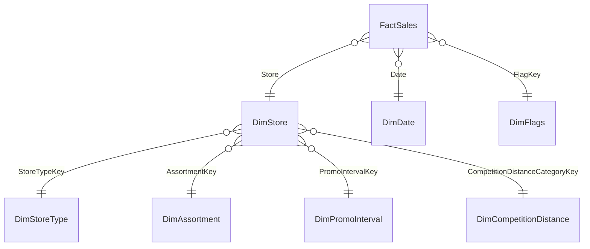

# Data Modeling (Data Engineering Track)

## Overview
This folder documents the Data Engineering track of the final project: building the SQL Server database, loading the cleaned data, splitting it into Fact and Dimension tables, and preparing the model for Power BI.

**Model type: Snowflake Schema** (not a Star Schema). `DimStore` is normalized into smaller dimension tables, so some dimensions connect to other dimensions instead of connecting directly to the fact table. Please use the name "Snowflake Schema" in the booklet, report, presentation and discussion.

## Tools
- SQL Server and SQL Server Management Studio (SSMS)
- Server instance: `.\SQLEXPRESS`
- Database: `FinalProject_DB`
- Power BI Desktop (SQL Server connection)

## Source Data (cleaned files received from the Data Prep track)
| File | Rows | Notes |
|---|---|---|
| `store_cleaned_1.csv` | 1,115 | One row per store, 14 columns |
| `train_cleaned.csv` | 1,017,209 | Contains `Sales` and `Customers`, dates from 2013-01-01 to 2015-07-31 |
| `test_cleaned.csv` | 41,088 | No `Sales` column, dates from 2015-08-01 to 2015-09-17 |

## What Was Done
1. Created the database `FinalProject_DB` on SQL Server.
2. Imported the three cleaned CSV files with **Import Flat File** into staging tables: `Store_Raw`, `Train_Raw`, `Test_Raw`.
3. Checked the row counts after the import against the source files.
4. Built the dimension tables and the fact table with SQL (`create_star_schema.sql`).
5. Applied the modeling rule: any repeated column with fewer than about 10 distinct values gets its own dimension table, while columns that are unique per row (for example `Store`) do not.
6. Linked all tables with Primary Keys and Foreign Keys.
7. Verified the row counts and that no `FlagKey` is empty in `FactSales`.
8. Wrote analysis queries to prove the model works (`queries.sql`).
9. Loaded the model tables into Power BI from SQL Server and set the relationships.

## Tables
| Table | Type | Rows | Key |
|---|---|---|---|
| `FactSales` | Fact | 1,017,209 | `Store` + `Date` (composite) |
| `DimStore` | Dimension | 1,115 | `Store` |
| `DimDate` | Dimension | 942 | `Date` |
| `DimFlags` | Dimension | 26 | `FlagKey` |
| `DimStoreType` | Dimension (sub-dimension of `DimStore`) | 4 | `StoreTypeKey` |
| `DimAssortment` | Dimension (sub-dimension of `DimStore`) | 3 | `AssortmentKey` |
| `DimPromoInterval` | Dimension (sub-dimension of `DimStore`) | 3 | `PromoIntervalKey` |
| `DimCompetitionDistance` | Dimension (sub-dimension of `DimStore`) | 3 | `CompetitionDistanceCategoryKey` |

**`FactSales` columns:** `Store`, `Date`, `Sales`, `Customers`, `Open`, `Promo`, `StateHoliday`, `SchoolHoliday`, `FlagKey`.

**`DimFlags`** groups the flag columns `Open`, `Promo`, `StateHoliday` and `SchoolHoliday` into one small table (26 combinations), linked to the fact table through `FlagKey`.

## Relationships (all Many-to-One, single direction)
| From (many side) | To (one side) |
|---|---|
| `FactSales[Store]` | `DimStore[Store]` |
| `FactSales[Date]` | `DimDate[Date]` |
| `FactSales[FlagKey]` | `DimFlags[FlagKey]` |
| `DimStore[StoreTypeKey]` | `DimStoreType[StoreTypeKey]` |
| `DimStore[AssortmentKey]` | `DimAssortment[AssortmentKey]` |
| `DimStore[PromoIntervalKey]` | `DimPromoInterval[PromoIntervalKey]` |
| `DimStore[CompetitionDistanceCategoryKey]` | `DimCompetitionDistance[CompetitionDistanceCategoryKey]` |

## Queries (`queries.sql`)
1. Total sales per year and store type.
2. Average sales on open days, promo vs no promo.
3. Top 10 stores by total sales.
4. Total sales and customers per assortment.
5. Average sales per day of week (open days only).
6. Average sales per competition distance category (open days only).

## Notes
- `Sales` is stored as `INT`, and the sum of sales is larger than the `INT` limit, so the queries use `CAST(... AS BIGINT)` for sums and `CAST(... AS FLOAT)` for averages to avoid an arithmetic overflow error.
- Stores without Promo2 information (544 stores in the source file) and stores without a competition distance category (3 stores) keep a `NULL` key in `DimStore`.
- `DimDate` covers the dates in the train file only.
- `Test_Raw` is kept as a separate table and is not part of the model, because it has no `Sales` column. It can be used for forecasting if the team decides so.
- The staging tables (`Store_Raw`, `Train_Raw`, `Test_Raw`) stay in SQL Server and are not loaded into Power BI.

## Files
| File | Description |
|---|---|
| `create_star_schema.sql` | Builds all dimension and fact tables in order |
| `queries.sql` | Analysis queries on the model |
